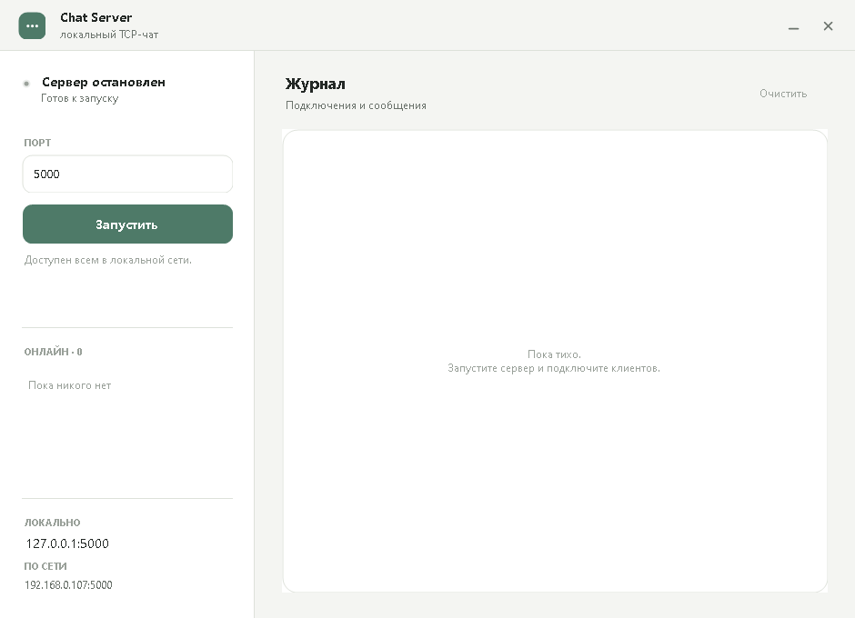
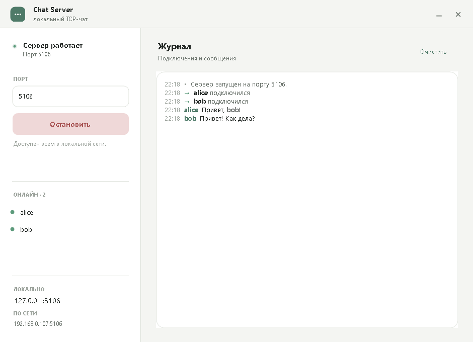
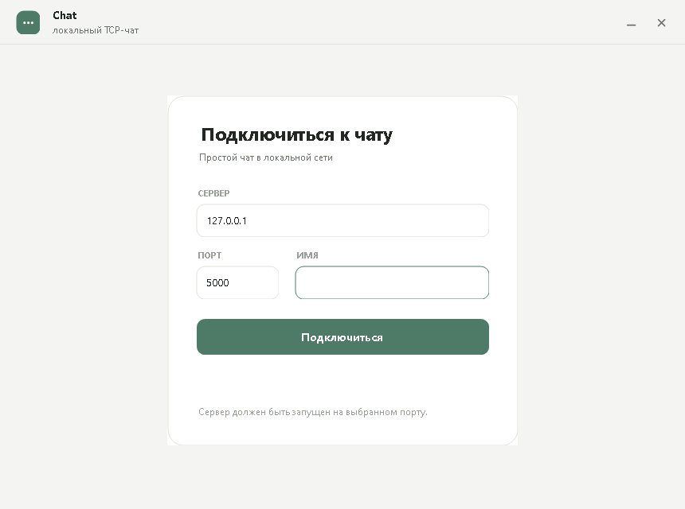
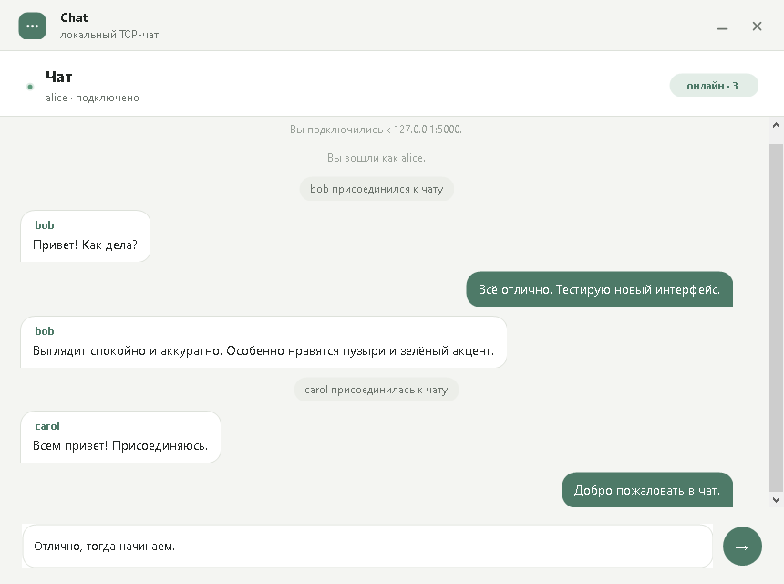

# TCP-чат на C#

Многопользовательский чат на TCP: сервер и клиент в двух вариантах — с графическим
интерфейсом (WinForms) и консольном. Вся сетевая логика вынесена в общую библиотеку
`Chat.Core`, визуальные компоненты — в `Chat.UI`.

Сервер принимает подключения и рассылает каждое сообщение всем участникам.

## Возможности

- Несколько клиентов одновременно, уникальные ники.
- Команды `/help`, `/nick`, `/users`, `/quit`.
- Уведомления о входе, выходе и смене имени.
- Графический сервер: статус, порт, запуск/остановка, список онлайн, журнал событий,
  локальный и сетевой адреса для подключения.
- Графический клиент: экран подключения и чат с пузырями сообщений, счётчиком онлайна
  и отправкой по Enter.

## Скриншоты

| Сервер до запуска | Сервер в работе |
|---|---|
|  |  |

| Экран подключения | Чат |
|---|---|
|  |  |

## Требования

- .NET SDK 10.0 (проект собран под `net10.0`)
- Для GUI — Windows (`net10.0-windows`, Windows Forms)
- Консольные версии работают на Windows / Linux / macOS

## Запуск GUI

Собрать решение:

```powershell
dotnet build Chat.slnx -c Release
```

Запустить сервер:

```powershell
dotnet run --project src/ChatServer.Gui
```

Укажите порт (по умолчанию 5000) и нажмите **Запустить**. В сайдбаре появятся
адреса для подключения — локальный `127.0.0.1` и адрес в локальной сети.

Запустить клиент (можно несколько копий):

```powershell
dotnet run --project src/ChatClient.Gui
```

Введите адрес сервера, порт и имя, затем нажмите **Подключиться**.

На Windows при первом запуске сервера разрешите приложению доступ в сеть
или создайте правило для входящих TCP-подключений на выбранный порт.

## Запуск консольных версий

Сервер (порт по умолчанию — 5000):

```powershell
dotnet run --project src/ChatServer
```

или с явным портом:

```powershell
dotnet run --project src/ChatServer -- 5000
```

Клиент (хост и порт по умолчанию — `127.0.0.1:5000`):

```powershell
dotnet run --project src/ChatClient
```

или с явными адресом и портом:

```powershell
dotnet run --project src/ChatClient -- 127.0.0.1 5000
```

Для чата с другого компьютера укажите IP-адрес сервера:

```powershell
dotnet run --project src/ChatClient -- 192.168.1.10 5000
```

## Команды чата

| Команда | Что делает |
|---|---|
| `/help` | Список команд |
| `/nick <имя>` | Сменить ник (до 20 символов) |
| `/users` | Показать участников |
| `/quit` или `/exit` | Выйти из чата |

Всё, что не начинается с `/`, отправляется как обычное сообщение.
Ник задаётся при подключении; если он занят, сервер добавит суффикс
(`alice` → `alice-2`).

## Как это работает

```
Клиент A ──┐
Клиент B ──┼── TCP ──► Сервер (TcpListener) ──► рассылка всем
Клиент C ──┘
```

- Транспорт — TCP, кодировка UTF-8, одно сообщение = одна строка (`\n`).
- Первая строка от клиента — желаемый ник.
- Сервер хранит подключения в `ConcurrentDictionary` (ник → сессия).
- Запись в один сокет защищена `SemaphoreSlim`, чтобы сообщения от разных
  клиентов не перемешивались внутри строки.
- Регистрация и смена ников выполняются под общей блокировкой.
- События `ChatServer` и `ChatConnection` поднимаются в захваченном
  `SynchronizationContext`, поэтому WinForms подписывается на них напрямую.
- Клиент читает сообщения сервера в фоновой задаче, а консольный ввод —
  через `Channel`, поэтому можно писать, не дожидаясь ответа.

### Структура

```
Chat.slnx
src/
  Chat.Core/            — общая сетевая логика
    ChatServer.cs       — приём подключений, команды, рассылка
    ServerSession.cs    — одно подключение: чтение, отправка, ник
    ChatConnection.cs   — клиентское подключение
    ChatLine.cs         — разбор строк протокола
    ChatProtocol.cs     — константы и нормализация ников
    ChatLogEntry.cs     — событие журнала сервера
  Chat.UI/              — общие WinForms-компоненты
    Theme.cs            — палитра, шрифты, скруглённые пути
    AppForm.cs          — окно без рамки, кнопки, логотип, статус, «таблетка»
    ChatFeed.cs         — лента сообщений с пузырями
    RoundedButton.cs    — кнопка со скруглением
    RoundedPanel.cs     — панель со скруглением
    RoundedTextBox.cs   — поле ввода со скруглением
  ChatServer.Gui/       — графический сервер (WinForms)
  ChatClient.Gui/       — графический клиент (WinForms)
  ChatServer/           — консольный сервер
  ChatClient/           — консольный клиент
docs/screenshots/       — скриншоты интерфейса
```

## Протокол (для справки)

Соединение одностороннее по смыслу, но двунаправленное по TCP:

1. Клиент отправляет строку с ником.
2. Сервер отвечает приветствием и рассылает остальным уведомление о входе.
3. Далее клиент отправляет строки-сообщения или команды.
4. Сервер рассылает сообщения в формате `ник: текст`, а служебные —
   с префиксом `[server]` или `*`.

## Возможные улучшения

- История сообщений для новых участников.
- Приватные сообщения (`/msg <ник> <текст>`).
- Ограничение длины сообщений и защита от флуда.
- TLS (`SslStream`) и аутентификация.
